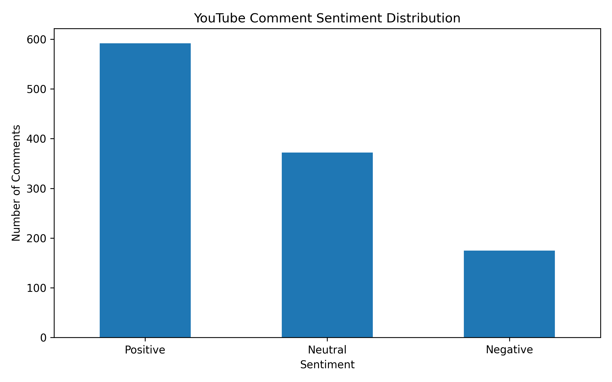
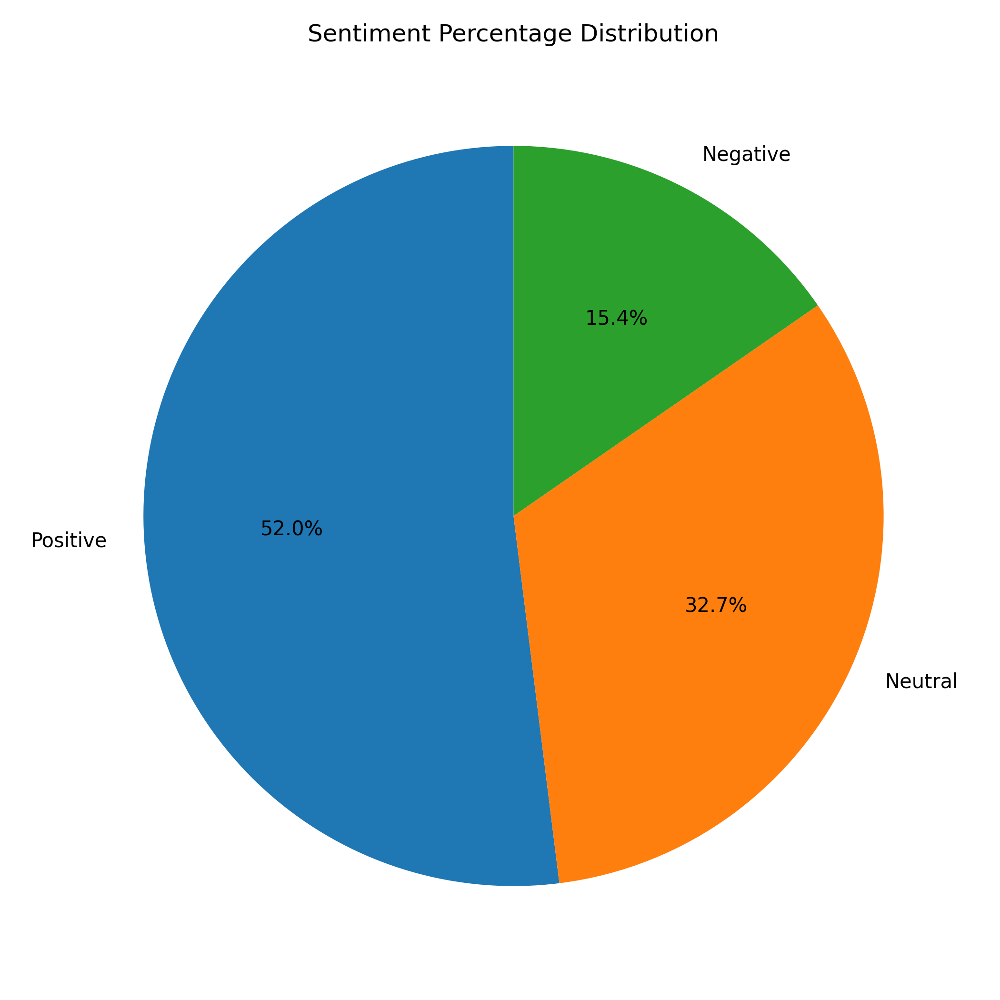

# YouTube Comment Sentiment Analysis

A Python project that collects YouTube comments and classifies their sentiment as **Positive**, **Neutral**, or **Negative** using VADER sentiment analysis.

## Project Overview

This project analyzes comments from the YouTube video [Lose 150 Lbs Together, Win $250,000](https://youtu.be/RE3_PGwDwhw?si=vzwLxURj4xPMA6dJ). It uses the YouTube Data API v3 to retrieve comments, removes duplicate comment text, analyzes the available comments, and creates charts and a report summarizing the results.

## Objectives

- Retrieve comments from a YouTube video using the YouTube Data API.
- Clean the collected data and remove duplicate comments.
- Apply VADER sentiment analysis to classify comments.
- Calculate sentiment counts, percentages, and the average compound score.
- Generate charts and save the results for further analysis.

## Tools and Technologies

- **Python** — main programming language
- **YouTube Data API v3** — comment retrieval
- **Pandas** — data cleaning and analysis
- **VADER Sentiment** — sentiment classification
- **Matplotlib** — data visualization
- **python-dotenv** — local API-key configuration
- **Visual Studio Code** — development environment

## Methodology

1. **Data collection:** Retrieve available top-level comments from the selected YouTube video.
2. **Data cleaning:** Remove duplicate comment text.
3. **Sampling:** Randomly select up to 2,000 unique comments using a fixed random seed. In this run, 1,139 unique comments were available, so all 1,139 were analyzed.
4. **Sentiment analysis:** Calculate a VADER compound score for each comment.
5. **Classification:** Assign a sentiment label using these thresholds:
   - Positive: compound score ≥ 0.05
   - Neutral: compound score > -0.05 and < 0.05
   - Negative: compound score ≤ -0.05
6. **Visualization and reporting:** Save CSV files, charts, and a Markdown report.

## Results

**Video analyzed:** [Lose 150 Lbs Together, Win $250,000](https://youtu.be/RE3_PGwDwhw?si=vzwLxURj4xPMA6dJ)

**Total unique comments analyzed:** 1,139

| Sentiment | Number of comments | Percentage |
|---|---:|---:|
| Positive | 592 | 51.98% |
| Neutral | 372 | 32.66% |
| Negative | 175 | 15.36% |
| **Total** | **1,139** | **100.00%** |

**Average VADER compound score:** 0.2489

The largest category was positive sentiment, followed by neutral and negative sentiment. The average compound score was positive. These results describe the analyzed comments and should not be treated as a representative survey of all viewers.

## Visualizations

### Sentiment Distribution



### Sentiment Percentages



## Project Files

```text
youtube-comment-sentiment-analysis/
├── main.py
├── requirements.txt
├── .gitignore
├── README.md
└── results/
    ├── youtube_comments.csv
    ├── youtube_sentiment_results.csv
    ├── sentiment_distribution.png
    ├── sentiment_percentages.png
    └── sentiment_report.md
```

## Setup and Installation

### 1. Clone the repository

Replace `YOUR-USERNAME` with your GitHub username.

```bash
git clone https://github.com/YOUR-USERNAME/youtube-comment-sentiment-analysis.git
cd youtube-comment-sentiment-analysis
```

### 2. Create and activate a virtual environment

On Windows PowerShell:

```powershell
python -m venv .venv
.\.venv\Scripts\Activate.ps1
```

### 3. Install dependencies

```bash
python -m pip install -r requirements.txt
```

### 4. Configure the YouTube API key

Create a local `.env` file in the project root:

```text
YOUTUBE_API_KEY=your_api_key_here
```

Replace the example value with your own YouTube Data API key. Keep `.env` private and never commit it to GitHub.

### 5. Run the project

```bash
python main.py
```

The program should retrieve available comments and generate the analysis outputs. Check `main.py` for the exact output location and configuration used by your version.

## Limitations

- Only 1,139 unique comments were available for this analysis, fewer than the target of 2,000.
- The analysis uses available top-level comments and does not include every possible reply.
- VADER may misclassify sarcasm, slang, context-dependent expressions, or mixed sentiment.
- Automated sentiment labels are estimates and may not reflect a comment's intended meaning.
- The results represent the collected comments, not necessarily the opinions of all viewers.

## References

- [YouTube Data API documentation](https://developers.google.com/youtube/v3)
- [VADER Sentiment Analysis](https://github.com/cjhutto/vaderSentiment)
- [Pandas documentation](https://pandas.pydata.org/docs/)
- [Matplotlib documentation](https://matplotlib.org/stable/)

## Author

Abdul-Moiz
who.abdulmoiz@gmail.com